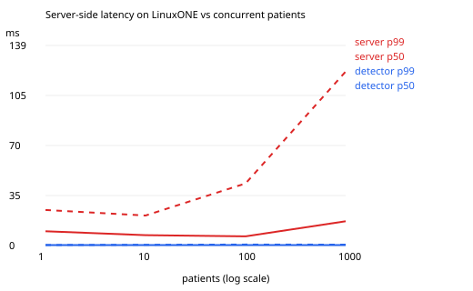

# Latency benchmark on LinuxONE

Generated by `python -m tools.benchmark.run_benchmark`. Client: laptop (Madrid) over the internet. Each patient sends 10 s of synthetic wrist signal every 10 s (accelerometer at 4 Hz, HR 1 Hz, EDA 4 Hz) 
for 150 s per level.

- `detector_ms`: detection compute inside the detector container (IBM Z).
- `server_ms`: ingest-api from `ingested_at` to the response (detector call, encrypted storage, audit), all on LinuxONE.
- `client_ms`: round trip seen by the client (adds TLS and the network).

|   patients |   requests |   errors |   requests_per_s |   detector_ms_p50 |   detector_ms_p99 |   server_ms_p50 |   server_ms_p99 |   client_ms_p50 |   client_ms_p99 |
|-----------:|-----------:|---------:|-----------------:|------------------:|------------------:|----------------:|----------------:|----------------:|----------------:|
|        1.0 |       15.0 |      0.0 |              0.1 |               0.3 |               0.4 |            10.3 |            13.4 |           344.0 |           391.0 |
|       10.0 |      150.0 |      0.0 |              1.0 |               0.3 |               0.5 |             8.1 |            21.1 |           125.0 |           195.7 |
|      100.0 |     1496.0 |      0.0 |             10.0 |               0.3 |               0.9 |             8.3 |            32.3 |           125.0 |           328.0 |
|     1000.0 |    14995.0 |      0.0 |            100.0 |               0.3 |               0.7 |            26.1 |           160.2 |           171.0 |           390.0 |

