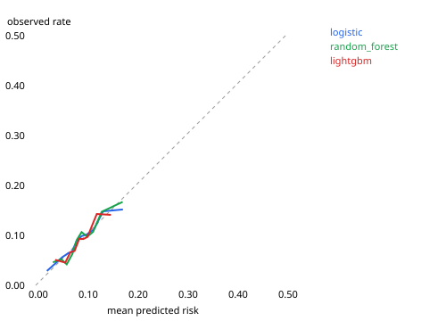
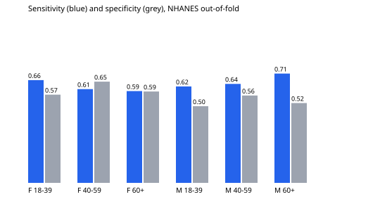

# Depression module: per-person validation

Generated by `python3 -m ml.models.train` on LinuxONE (s390x). Label: PHQ-9 >= 10 in NHANES (depressive symptoms, not a diagnosis); patient vs control in DEPRESJON. One row per person; every split is checked for person leakage. Probabilities are isotonic-calibrated on the training fold; a person is classified positive when the calibrated risk is at least the training prevalence (rule fixed in advance).

## NHANES G+H, 5-fold GroupKFold by person

| model         |   auc | auc_95ci   |   mcc | mcc_95ci   |    f1 |   sensitivity |   specificity |   brier |   people |   positives |
|:--------------|------:|:-----------|------:|:-----------|------:|--------------:|--------------:|--------:|---------:|------------:|
| logistic      | 0.626 | 0.61-0.65  | 0.106 | 0.08-0.13  | 0.208 |         0.617 |         0.565 |   0.082 |     7965 |         731 |
| random_forest | 0.633 | 0.61-0.65  | 0.113 | 0.09-0.14  | 0.212 |         0.632 |         0.564 |   0.082 |     7965 |         731 |
| lightgbm      | 0.613 | 0.59-0.63  | 0.093 | 0.07-0.11  | 0.200 |         0.648 |         0.513 |   0.082 |     7965 |         731 |

Best population model (highest NHANES AUC): **random_forest**; it is the one used for the calibration and fairness analysis below.

## External test: trained on all NHANES, tested on DEPRESJON (55 people)

| model         |   auc | auc_95ci   |    mcc | mcc_95ci   |    f1 |   sensitivity |   specificity |   brier |   people |   positives |
|:--------------|------:|:-----------|-------:|:-----------|------:|--------------:|--------------:|--------:|---------:|------------:|
| logistic      | 0.440 | 0.30-0.60  | -0.017 | -0.28-0.24 | 0.491 |         0.609 |         0.375 |   0.351 |       55 |          23 |
| random_forest | 0.571 | 0.41-0.73  |  0.120 | -0.14-0.36 | 0.567 |         0.739 |         0.375 |   0.343 |       55 |          23 |
| lightgbm      | 0.584 | 0.41-0.74  |  0.049 | -0.23-0.33 | 0.419 |         0.391 |         0.656 |   0.351 |       55 |          23 |

Threshold = NHANES prevalence; DEPRESJON prevalence is 42 %, so AUC (threshold-free) is the fairest summary of transfer.

## DEPRESJON leave-one-subject-out (plan B, CLAUDE.md section 14)

| model         |   auc | auc_95ci   |   mcc | mcc_95ci   |    f1 |   sensitivity |   specificity |   brier |   people |   positives |
|:--------------|------:|:-----------|------:|:-----------|------:|--------------:|--------------:|--------:|---------:|------------:|
| logistic      | 0.822 | 0.69-0.94  | 0.626 | 0.41-0.82  | 0.783 |         0.783 |         0.844 |   0.184 |       55 |          23 |
| random_forest | 0.720 | 0.57-0.85  | 0.336 | 0.07-0.58  | 0.625 |         0.652 |         0.688 |   0.217 |       55 |          23 |
| lightgbm      | 0.747 | 0.60-0.88  | 0.411 | 0.15-0.65  | 0.667 |         0.696 |         0.719 |   0.206 |       55 |          23 |

## Deployed module

Transfer AUC of the population model on DEPRESJON: 0.57 (below the 0.65 threshold). CLAUDE.md section 14 planned this fallback before any training; the numeric threshold was written into this script after a first run, but any value between 0.60 and 0.70 gives the same decision. **Plan B applies**: the deployed depression module is trained on DEPRESJON (clinically diagnosed patients vs controls) and chosen by leave-one-subject-out AUC among portable models; NHANES provides the reference ranges, the population analysis and the fairness check.

Deployed: `logistic` trained on `depresjon` (55 people), calibration `platt`, threshold 0.418.

Published person-level reference on DEPRESJON: F1 0.73, MCC 0.44 (Garcia-Ceja et al. 2018). Results above 95 % accuracy reported elsewhere usually mix days of the same person between train and test.

## Calibration (NHANES out-of-fold)

| model         |   expected_calibration_error |
|:--------------|-----------------------------:|
| logistic      |                        0.007 |
| random_forest |                        0.010 |
| lightgbm      |                        0.009 |

## Fairness: random_forest, NHANES out-of-fold, by sex and age group

| group   |   people |   positives |   sensitivity |   specificity |   auc |
|:--------|---------:|------------:|--------------:|--------------:|------:|
| F 18-39 |     1361 |         128 |         0.664 |         0.570 | 0.652 |
| F 40-59 |     1354 |         198 |         0.606 |         0.654 | 0.681 |
| F 60+   |     1391 |         150 |         0.593 |         0.591 | 0.625 |
| M 18-39 |     1385 |          77 |         0.623 |         0.495 | 0.590 |
| M 40-59 |     1184 |          86 |         0.640 |         0.565 | 0.646 |
| M 60+   |     1290 |          92 |         0.707 |         0.516 | 0.651 |

## Limitations

- PHQ-9 measures symptoms at one time point; activity was recorded on other days.
- Hourly activity only (no heart rate in NHANES): sleep features are proxies.
- NHANES and DEPRESJON use different devices and populations; features keep the same direction for only some features (`ml/reports/features_summary.md`).
- DEPRESJON has 55 people: the 95 % intervals are wide and leave-one-subject-out on one clinic and one device is the most optimistic of the three settings.
- Leave-one-out pooled AUC can be biased downwards for near-constant models (the training prevalence moves against the held-out label); minimum leaf sizes scale with the sample to avoid constant trees.
- The deployed DEPRESJON model is chosen by the same leave-one-subject-out AUC that is reported for it (two portable candidates), which is slightly optimistic.
